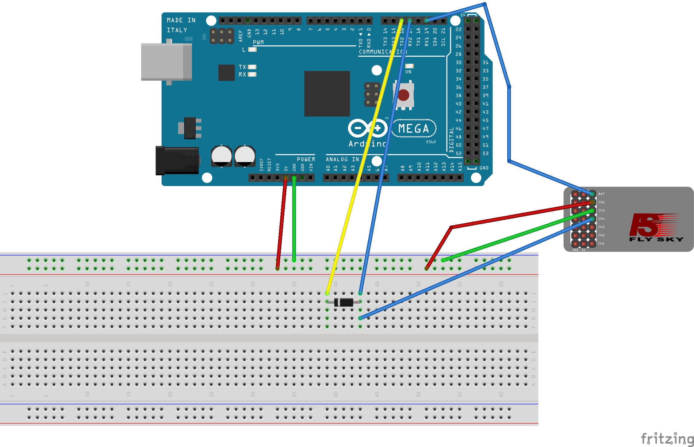

  [](https://github.com/jerome1232/bajols/actions/workflows/build-groundstation.yml) [](https://github.com/jerome1232/bajols/actions/workflows/test-firmware-protocol.yml)

# bajols
Remotely controlled submarine with planned semi-autonomous operation.

The repository includes experimental Arduino firmware, a portable BCP protocol
library, and a C# desktop ground station with an encoded simulated peer. The
`TelemetryProof` sketch fakes sensor data to demonstrate telemetry streaming to
a FS-i6X controller and reading its inputs. BCP actuator integration is deferred.

Currently it will react to throttle (left joystick) and in response will
change rpms. It will also react to swC switch, while in the up position it will
decrease pressure, in middle postion not change pressure, and when in down postion
increase pressure. You should see changes to altitute as pressure changes.

It constantly changes heading (shown as '5' sensor on flysky remote)
Currently heading is 0..360 degrees.

## Repository layout

```text
firmware/
  Experimental/
    TelemetryProof/    # Existing Arduino sketch and supporting source files
    BcpCodecCheck/      # Isolated BCP codec compile check; no actuator setup
    BcpSessionCheck/    # Session policy compile check; no hardware initialization
    BcpSerialCheck/     # Bounded USB-serial endpoint; identity remains unverified
    BcpStorageCheck/    # Experimental identity journal with a RAM-only backend
    BcpEepromCheck/     # Mega EEPROM/coordinator compile check; writes disabled
    BcpMonitor/         # Verified startup + BCP monitoring; explicit write opt-in
    Wiring/            # Experimental wiring diagrams
  Libraries/           # Portable BajolsProtocol library and bundled archive
  tests/bcp/           # Shared vectors, state, transport and storage/startup tests
  tools/               # Offline initial identity image/readback tooling
Documentation/         # Sensor notes and receiver wiring documentation
protocol/              # BCP specification, conformance plan and shared wire vectors
groundstation/         # .NET/Avalonia ground station, simulator and tests
```

The firmware was moved from `src/` without changing its behavior. The Arduino
sketch remains experimental and does not implement BCP. The C# protocol codec, simulated peer and desktop ground station are implemented
under `groundstation/`.
The [BCP v1 discussion draft](protocol/BCP_V1_DRAFT.md) records agreed control and
safety behavior separately from proposed wire details and open decisions.
The [ground station](groundstation/README.md) separates protocol, communication,
domain, input, configuration and UI code. It starts disconnected and includes an
encoded BCP simulator, explicit session/control actions, validated YAML, live status
and bounded serial communication. The bundled configuration selects simulation.
Telemetry and plain-language vehicle status overlay the 3D view, including neutral
qualification progress and a colour-coded 0–4.5 m depth gauge. The control panel
provides a combined movement pad, pitch slider and three-position buoyancy selector.
Simulated object reports cover a provisional 0–6 m range; stale markers fade to
grey/white. See the ground-station guide for input qualification, object placement
and the limits of this schematic display.

## Compile
Libraries needed to compile this sketch - If not included in repo it's installable from arudino IDE.

|Library|Location in Repo|Web link|Version|
|-------|----------------|-------|-------|
|IBusBM|/firmware/Libraries/IBusBM-1.1.4.zip|[bmellink/IBusBM](https://github.com/bmellink/IBusBM)|1.1.4
|Servo|-|[Servo](https://github.com/arduino-libraries/Servo.git)|1.3.0
|Encoder|-|[Encoder](https://github.com/PaulStoffregen/Encoder)|1.4.4
|Adafruit_BusIO|-|[Adafruit_BusIO](https://github.com/adafruit/Adafruit_BusIO)|1.17.4
|Adafruit_PWM-Servo-Driver|-|[Servo-Driver](https://github.com/adafruit/Adafruit-PWM-Servo-Driver-Library)|3.0.2

Open [TelemetryProof.ino](firmware/Experimental/TelemetryProof/TelemetryProof.ino)
in the Arduino IDE and select Arduino Mega 2560. Compile CI and Arduino Lint both
target `firmware/Experimental/TelemetryProof`; compile CI also builds the isolated
`BcpCodecCheck`, `BcpSessionCheck`, `BcpSerialCheck`, `BcpStorageCheck`, `BcpEepromCheck` and `BcpMonitor` sketches with the local
`BajolsProtocol` library.

The [portable firmware protocol library](firmware/Libraries/BajolsProtocol/README.md)
contains the BCP codec, a session/authorization manager and a bounded serial endpoint.
It is not yet
connected to the vehicle control loop. An experimental identity/emergency journal
models the [storage policy](protocol/FIRMWARE_STORAGE_PROPOSAL.md) in RAM.
The Mega EEPROM adapter and persistence coordinator are implemented; supplied
sketches default to EEPROM writes disabled and never provision identity. The
[offline tooling](firmware/tools/README.md) prepares reviewable initial images;
`BcpMonitor` can use provisioned identity for actuator-free monitoring only after
explicit write-enabled build configuration. Run protocol, stateful, transport
and power-loss tests with `python3 firmware/tests/bcp/run_native_tests.py`.

## Wiring
To wire reciever see this diagram

